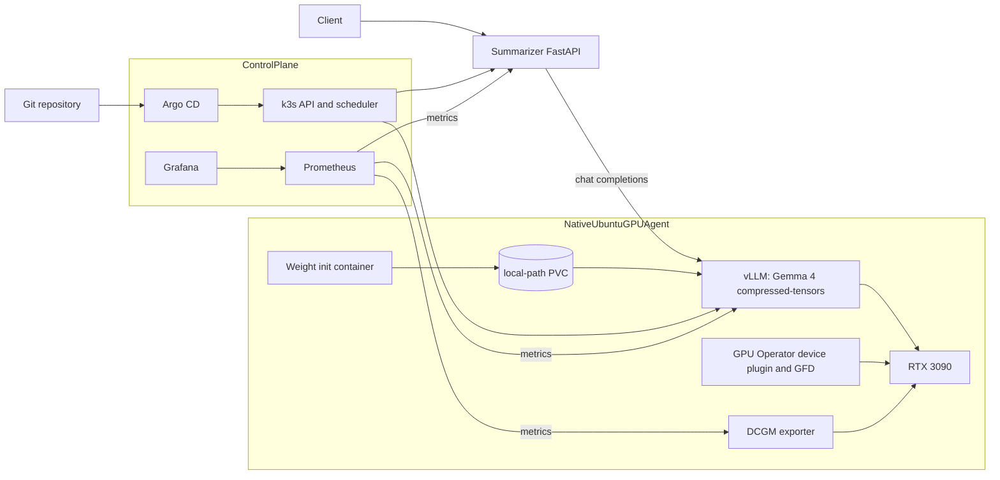

# Architecture

One control plane plus one native Ubuntu GPU agent is the requested topology. GPU workloads require both GPU labels, the GPU taint toleration, the `nvidia` RuntimeClass, and an exclusive GPU resource. CPU services have no GPU toleration and land on the control plane. System DaemonSets may tolerate the taint. This isolates user workloads but is not a security boundary.

The service calls `/v1/chat/completions`; readiness checks `/health`, while liveness checks only its own process. A failed model therefore removes app readiness without repeatedly restarting a healthy app. vLLM readiness and liveness both use `/health`; its startup probe gates them during load. A persistent HF cache survives model pod replacement. Recreate avoids a rollout deadlock on the sole GPU.

Argo CD reconciles desired state from Git. Monitoring CRDs precede custom monitors and rules. Grafana discovers dashboard ConfigMaps across namespaces. Sealed Secrets decrypts only cluster-bound ciphertext. ClusterIP services deliberately have no public ingress: authentication, TLS and exposure policy must be selected before any public service is added.
