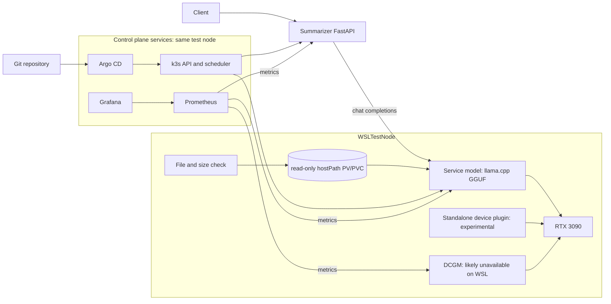

# Architecture

The default test is one k3s server node inside a new WSL2 distro. The native alternative remains a separate control plane plus GPU agent. GPU workloads require both GPU labels, the GPU taint toleration, the `nvidia` RuntimeClass, and an exclusive GPU resource. The WSL profile deliberately adds GPU-taint tolerations to CPU services because they share the only node. Native GPU isolation uses the separate control plane instead. System DaemonSets may tolerate the taint. This isolates user workloads but is not a security boundary.

The service calls `/v1/chat/completions`; readiness checks `/health`, while liveness checks only its own process. A failed model therefore removes app readiness without repeatedly restarting a healthy app. Model readiness and liveness both use `/health`; its startup probe gates them during load. A retained read-only PV/PVC points at the existing GGUF; initialization verifies its presence and byte size. The vLLM alternative retains its HF cache chart. Recreate avoids a rollout deadlock on the sole GPU.

Argo CD reconciles desired state from Git. Monitoring CRDs precede custom monitors and rules. Grafana discovers dashboard ConfigMaps across namespaces. Sealed Secrets decrypts only cluster-bound ciphertext. ClusterIP services deliberately have no public ingress: authentication, TLS and exposure policy must be selected before any public service is added.
